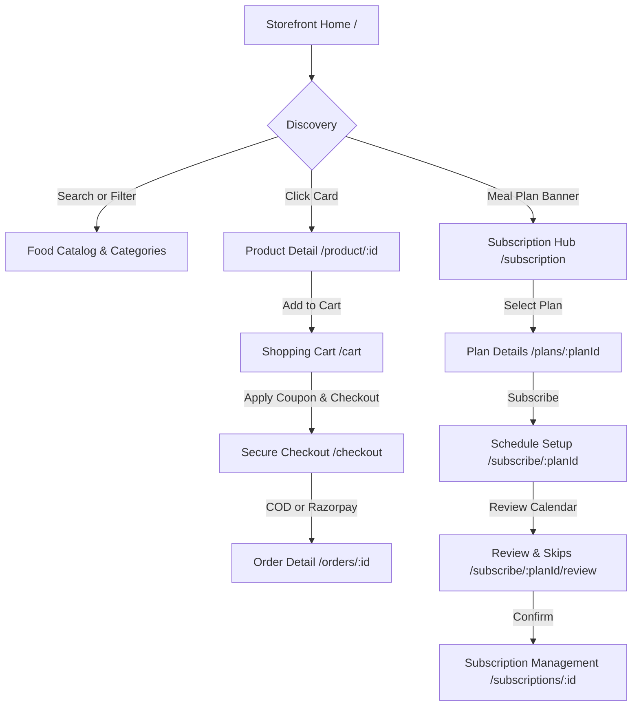

# Manoharam Real Foods — Storefront UI/UX Reverse Engineering & Design Specification

> **Document Status**: Production Reverse-Engineered Specification  
> **Source Repository**: `storefront/`  
> **Target Audience**: Frontend Engineers, UI/UX Designers, AI Agents, Technical Product Managers  
> **Brand Tagline**: *“Safe, as your mother's home.”*  

---

## 1. Application Overview

### 1.1 Purpose of the Storefront
The **Manoharam Real Foods Storefront** is a food-first, high-trust e-commerce and subscription web application. It is engineered to sell traditional South Indian delicacies—including handcrafted pickles, thokkus, podis, artisanal masalas, and scheduled weekly meal rotations. The storefront emphasizes purity, culinary heritage, homestyle care, and transparent ingredient sourcing (100% cold-pressed oils, zero chemical preservatives or synthetic colors).

### 1.2 Intended Users
- **Direct Shoppers**: Customers purchasing individual jars of pickles, seasonal powders, and pantry delicacies for immediate home delivery.
- **Meal Subscribers**: Working professionals, families, and fitness enthusiasts subscribing to recurring weekly meal deliveries (lunch packs, dietary bowls, dinner rotations) with flexible calendar management (1-tap date skipping, pause/resume, custom duration).
- **Returning Customers**: Patrons managing repeat orders, tracking live preparation and dispatch, maintaining saved delivery address books, and monitoring billing invoices.

### 1.3 Visual Identity & Personality
- **Editorial Culinary Heritage**: Balanced between time-honored artisanal tradition and sleek modern convenience.
- **Color Temperature**: Warm kitchen parchment (`#FAF6EF`), deep chili red (`#C1272D` / `#9B2C2C`), rich turmeric amber (`#D97706`), and charcoal espresso typography (`#1C1917`).
- **Typography Philosophy**: High-contrast pairing of authentic editorial serif display headings (**DM Serif Display**) with crisp, geometric, accessible sans-serif interface typography (**Plus Jakarta Sans**).
- **Core Emotional Hook**: Warmth, hygiene, and domestic reassurance embodied by the official motto: *“Safe, as your mother's home.”*

### 1.4 Architecture & Layout Philosophy
The storefront employs an **AppShell** wrapper pattern (`storefront/src/components/layout/AppShell.jsx`) with responsive layout switching:
- **Mobile (< 768px)**: Sticky ultra-compact app header (`MobileTopBar.jsx`) with brand logo, live cart bubble, and search shortcut; dedicated fixed bottom tab bar (`BottomNav.jsx`) with 4 primary destinations (Menu, Plans, Alerts, Account); sticky floating action bars on transaction pages (Cart, Checkout, Product Detail).
- **Desktop (≥ 768px)**: Sticky glassmorphism header (`TopNav.jsx`) with centered navigation links, integrated search pill, cart counter bubble, notification bell, user profile pill, and sign-in button.
- **Content Area**: Fluid container bounded to `max-w-7xl` (or page-specific `max-w-5xl`, `max-w-2xl`, `max-w-md`) centered horizontally with padded gutter breathing room.
- **Footer**: Comprehensive 4-column brand and directory footer (`Footer.jsx`) showcasing kitchen standards, navigation links, and copyright info.

### 1.5 Primary User Journeys


---

## 2. Complete Design System & Tokens

### 2.1 Colour Palette
Extracted directly from `storefront/src/index.css` (`@theme` block) and component styling:

| Token Name | Exact HEX | RGB Value | Primary Usage & Semantics |
| :--- | :--- | :--- | :--- |
| `--color-chili-50` | `#FDF2F2` | `rgb(253, 242, 242)` | Subtle error alerts, selected card hover tint |
| `--color-chili-100` | `#FCE4E4` | `rgb(252, 228, 228)` | Active nav item background, pill button badges, avatar ring |
| `--color-chili-200` | `#F9C5C5` | `rgb(249, 197, 197)` | Soft warning/error borders, card dashed outlines |
| `--color-chili-300` | `#F49D9D` | `rgb(244, 157, 157)` | Accent dividers, decorative focus halos |
| `--color-chili-400` | `#E55353` | `rgb(229, 83, 83)` | Form error text, high-visibility interactive warnings |
| `--color-chili-500` | `#C1272D` | `rgb(193, 39, 45)` | **Primary Heritage Red Brand Color** (Brand Logo, primary CTA focus) |
| `--color-chili-600` | `#9B2C2C` | `rgb(155, 44, 44)` | **Primary Storefront Action Color** (Buttons, active icons, price headings) |
| `--color-chili-700` | `#7B1F23` | `rgb(123, 31, 35)` | Primary button hover state, deep crimson borders |
| `--color-chili-800` | `#5C1518` | `rgb(92, 21, 24)` | Deep contrast headings, hero dark gradient stops |
| `--color-chili-900` | `#3E0C0E` | `rgb(62, 12, 14)` | Shadow tint, ultra-dark red contrast borders |
| `--color-amber-50` | `#FFFDF5` | `rgb(255, 253, 245)` | Light turmeric surface, notification highlights |
| `--color-amber-100` | `#FEF7DA` | `rgb(254, 247, 218)` | Alert background, promo badge surface |
| `--color-amber-200` | `#FDEBB2` | `rgb(253, 235, 178)` | Tagline badge text, star ratings border |
| `--color-amber-300` | `#FBD778` | `rgb(251, 215, 120)` | Warm saffron border accents |
| `--color-amber-400` | `#F5B83D` | `rgb(245, 184, 61)` | Star review fill, pending delivery badges |
| `--color-amber-500` | `#D97706` | `rgb(217, 119, 6)` | Star rating icons, pending order badges, warning indicators |
| `--color-cream-50` | `#FFFEFC` | `rgb(255, 254, 252)` | **Card Surface Background**, modal body, dropdown items |
| `--color-cream-100` | `#FAF6EF` | `rgb(250, 246, 239)` | **Global Page Background**, AppShell base canvas |
| `--color-cream-200` | `#F3EBDD` | `rgb(243, 235, 221)` | Image skeleton placeholder bg, stepper button hover |
| `--color-cream-300` | `#E6D9C5` | `rgb(230, 217, 197)` | **Standard Component Border**, divider lines, input borders |
| `--color-cream-400` | `#D1BFA5` | `rgb(209, 191, 165)` | Subdued borders, table horizontal separators |
| `--color-cream-500` | `#BC9F7E` | `rgb(188, 159, 126)` | Muted warm parchment borders |
| `--color-ink-950` | `#14110F` | `rgb(20, 17, 15)` | High-contrast display headlines, modal dark backdrop |
| `--color-ink-900` | `#1C1917` | `rgb(28, 25, 23)` | **Primary Body Text**, titles, card titles |
| `--color-ink-700` | `#44403C` | `rgb(68, 64, 60)` | Secondary text, form labels, footer link items |
| `--color-ink-500` | `#78716C` | `rgb(120, 113, 108)` | Muted body copy, timestamps, units, category captions |
| `--color-ink-400` | `#928B84` | `rgb(146, 139, 132)` | Subtitle text, placeholder icons, empty state icons |
| `--color-ink-300` | `#A8A29E` | `rgb(168, 162, 158)` | Placeholder inputs, disabled chevrons |
| `--color-success-500`| `#15803D` | `rgb(21, 128, 61)` | **Vegetarian Mark**, Free Delivery tag, Active cycle badge |
| `--color-success-100`| `#DCFCE7` | `rgb(220, 252, 231)` | Success notice surface, coupon applied bg, in-stock tag |
| `--color-warning-500`| `#D97706` | `rgb(217, 119, 6)` | Pending order status, weekend notice |
| `--color-warning-100`| `#FEF3C7` | `rgb(254, 243, 199)` | Pending status pill background |
| `--color-danger-500` | `#C1272D` | `rgb(193, 39, 45)` | Error pill, cancel order CTA, delete item icon |
| `--color-danger-100` | `#FDF2F2` | `rgb(253, 242, 242)` | Error card surface, cancelled order pill bg |

---

### 2.2 Typography Specification

```css
Display Font: 'DM Serif Display', Georgia, serif;
Body & UI Font: 'Plus Jakarta Sans', system-ui, -apple-system, BlinkMacSystemFont, sans-serif;
```

| Hierarchy Level | Font Family | Size (Mobile / Desktop) | Weight | Line Height | Tracking | Text Transform |
| :--- | :--- | :--- | :--- | :--- | :--- | :--- |
| **Hero H1** | DM Serif Display | `24px` / `48px` (`text-2xl` / `text-5xl`) | 700 (Bold) | `1.15` | `-0.025em` | Normal |
| **Section H2** | DM Serif Display | `20px` / `24px` (`text-xl` / `text-2xl`) | 700 (Bold) | `1.25` | `-0.015em` | Normal |
| **Card H3** | DM Serif Display | `14px` / `16px` (`text-sm` / `text-base`) | 700 (Bold) | `1.3` | `-0.01em` | Normal |
| **Product Card Title**| Plus Jakarta Sans | `12px` / `14px` (`text-xs` / `text-sm`) | 600 (Semibold)| `1.25` | Normal | Normal |
| **Price Main** | DM Serif Display | `16px` / `24px` (`text-base` / `text-2xl`)| 700 (Bold) | `1.0` | Normal | Tabular numbers |
| **Price Suffix** | Plus Jakarta Sans | `10px` / `12px` (`text-[10px]` / `text-xs`)| 400 (Regular) | `1.0` | Normal | Normal |
| **Brand Tagline** | DM Serif Display | `10px` / `14px` | 400 (Italic) | `1.0` | `+0.01em` | Italic |
| **Body Standard** | Plus Jakarta Sans | `12px` / `14px` (`text-xs` / `text-sm`) | 400 / 500 | `1.5` | Normal | Normal |
| **Form Label** | Plus Jakarta Sans | `12px` (`text-xs`) | 700 (Bold) | `1.2` | Normal | Normal |
| **Form Input** | Plus Jakarta Sans | `12px` / `14px` | 400 / 500 | `1.4` | Normal | Normal |
| **Button Action**| Plus Jakarta Sans | `12px` / `14px` | 700 (Bold) | `1.0` | Normal | Normal |
| **Category Pill** | Plus Jakarta Sans | `10px` / `12px` | 700 (Bold) | `1.0` | `+0.05em` | Uppercase |

---

### 2.3 Spacing, Borders, Shadows & Radius

```css
--radius-card: 1rem (16px);
--radius-pill: 9999px (full rounded pill);
```

- **Page Margins**: `px-4 sm:px-6 lg:px-8`
- **Section Vertical Gap**: `space-y-6 sm:space-y-8 pb-10`
- **Component Border Standard**: `border border-[#E6D9C5]` (Warm cream parchment border, 1px solid)
- **Component Soft Border**: `border border-[#E6D9C5]/60` or `border-[#E6D9C5]/80`
- **Active Card Border**: `hover:border-[#9B2C2C]/30 hover:shadow-md`
- **Vegetarian Accent Border**: `border-l-4 border-l-[#15803D]`
- **Non-Vegetarian Accent Border**: `border-l-4 border-l-[#9B2C2C]`
- **Shadow Elevations**:
  - `shadow-2xs`: Subtle card boundary (`box-shadow: 0 1px 2px rgba(28,25,23, 0.04)`)
  - `shadow-xs`: Primary card elevation (`box-shadow: 0 1px 3px rgba(28,25,23, 0.06)`)
  - `shadow-md`: Interactive card hover elevation (`box-shadow: 0 4px 6px -1px rgba(155,44,44, 0.08)`)
  - `shadow-lg`: Fixed mobile bottom action bar elevation (`box-shadow: 0 10px 15px -3px rgba(28,25,23, 0.1)`)

---

### 2.4 Icons and Visual Assets
- **Icon Library**: `lucide-react` (SVG strokes with `strokeWidth={2}` or `strokeWidth={1.5}`)
- **Brand Logo Asset**: `storefront/src/assets/logo.png` (Handcrafted authentic Manoharam logo emblem)
- **Hero Photography Banner**: `storefront/src/assets/food/hero-banner.jpg` (Handcrafted South Indian dishes prepared with cold-pressed oils)
- **Vegetarian Badge (`VegBadge`)**:
  - Exact HTML/CSS: `<span className="inline-flex h-3.5 w-3.5 items-center justify-center rounded-[2px] border-[1.5px] border-[#15803D] bg-white"><span className="h-1.5 w-1.5 rounded-full bg-[#15803D]" /></span>`
  - Visual: Green 1.5px bordered square with a 6px centered green circle on white background.
- **Dietary Mark (`DietaryMark`)**:
  - Veg: Green border + green circle (`#15803D`).
  - Non-Veg: Crimson border + crimson circle (`#9B2C2C`).

### 2.5 Dynamic Product & Subscription Image Architecture
Implemented in `storefront/src/components/ProductImage.jsx`:
1. **Backend as Sole Source of Truth**: Images are retrieved dynamically via PHP backend uploads (`uploads/foods_profiles/...` or full URL).
2. **URL Resolution Engine (`imageHelper.js`)**: Converts relative backend paths to absolute URLs against `http://localhost/Manoharam-Real-Foods/`.
3. **No Stock Photo Substitution**: Never falls back to random Unsplash photos or incorrect food photographs.
4. **Branded Vector Fallback (`ProductPlaceholder`)**:
   - Container: `bg-gradient-to-br from-[#FAF6EF] via-[#F3EBDD] to-[#FEF7DA]/60 border border-[#E6D9C5]/70`
   - Icon Resolver:
     - Subscription / Plan / Box: Lucide `Package` icon (`strokeWidth={1.5}`)
     - Salad / Bowl / Green: Lucide `Salad` icon (`strokeWidth={1.5}`)
     - Delicacy / Dish / Pickle: Lucide `UtensilsCrossed` icon (`strokeWidth={1.5}`)
   - Icon Tint: `#C1272D`/60 (Branded Heritage Red at 60% opacity)
   - Accessibility: `role="img"`, `title={alt}`, and screen-reader hidden description.

---

## 3. Complete Page-by-Page Design Documentation

The Storefront implements **16 complete routes**.

```
1. /                              -> Home.jsx
2. /search                        -> SearchPage.jsx
3. /product/:id                   -> ProductDetail.jsx
4. /login                         -> Login.jsx
5. /register                      -> Register.jsx
6. /subscription                  -> Subscription.jsx
7. /plans/:planId                 -> PlanDetails.jsx
8. /cart                          -> Cart.jsx (Protected)
9. /checkout                      -> Checkout.jsx (Protected)
10. /orders                       -> Orders.jsx (Protected)
11. /orders/:id                   -> OrderDetail.jsx (Protected)
12. /subscribe/:planId            -> SubscriptionSetup.jsx (Protected)
13. /subscribe/:planId/review     -> SubscriptionReview.jsx (Protected)
14. /subscriptions/:id            -> SubscriptionDetails.jsx (Protected)
15. /notifications                -> Notifications.jsx (Protected)
16. /profile                      -> Profile.jsx (Protected)
```

---

### PAGE 1: Home Page (`/`)
- **Source File**: `storefront/src/pages/Home.jsx`
- **Route**: `/`
- **Authentication**: Public
- **Allowed Roles**: All visitors & authenticated customers
- **Parent Layout**: `<AppShell>`

#### Visual Structure (Top to Bottom):
1. **Mobile Top Bar** (mobile) / **Top Navigation Bar** (desktop).
2. **Today's Delivery Banner** (`TodayDeliveryBanner.jsx`): Renders dynamically if the authenticated user has an active scheduled meal delivery for today.
3. **Food-First Hero Section**:
   - Hero banner image (`hero-banner.jpg`) with dark-to-warm gradient overlay (`from-black/85 via-black/65 to-black/30`).
   - Official Logo (`logo.png`, `h-9 sm:h-11`) + Brand Name `"Manoharam Real Foods"`.
   - Mandatory Tagline Pill: `“Safe, as your mother's home.”` in italic amber serif font with glassmorphic backdrop.
   - Headline H1: `"Handcrafted Traditional Food, Made Pure"`
   - Subtitle: `"Prepared in small batches with cold-pressed oils, natural ingredients, and authentic homestyle care."`
   - CTAs: `"Shop Now"` (scrolls smoothly to `#products`) and `"Meal Plans"` (links to `/subscription`).
4. **Category Discovery Grid**:
   - Grid of category cards (`grid-cols-2 sm:grid-cols-3 gap-3 sm:gap-4`).
   - Dynamically generated from backend products: Displays category image thumbnail, category name, and subtitle `"Browse selection"`.
   - Static Special Tile: `"Weekly Meal Plans"` with subtitle `"Scheduled delivery"`, linking to `/subscription`.
5. **Products Catalog Section (`#products`)**:
   - Section Header: Dynamic title (`"Our Food Catalog"` or selected category name) and count indicator (`"{N} items available"`).
   - Category Filter Bar: Horizontal scrollable pill buttons (`All`, `Pickles`, `Thokku`, `Masalas`, etc.) + `"Search"` button shortcut.
   - Products Grid: `grid-cols-2 gap-3 sm:gap-4 md:grid-cols-3 lg:grid-cols-4`.
   - Infinite Pagination: `"Load more products"` button with Chevron icon.
6. **Weekly Subscription Promo Banner**:
   - Warm parchment gradient banner (`from-[#FAF6EF] via-[#FFFDF9] to-[#F5ECE1]`).
   - Header: `"Scheduled Service"` (uppercase crimson badge), `"Weekly Food & Meal Subscriptions"`.
   - Subtitle: `"Fresh home-style delivery on your schedule. 1-tap date skipping anytime."`
   - CTA: `"Explore Weekly Plans"` linking to `/subscription`.
7. **Brand Trust Note**:
   - Compact banner with logo, brand name, tagline, and copy: `"Prepared in small batches with 100% cold-pressed oils, sun-cured spices, and pure homestyle care. Zero artificial preservatives."`
8. **Footer** (`Footer.jsx`).

#### Exact Visible Text (Verbatim):
- Tagline: `“Safe, as your mother's home.”`
- Hero H1: `Handcrafted Traditional Food, Made Pure`
- Hero Sub: `Prepared in small batches with cold-pressed oils, natural ingredients, and authentic homestyle care.`
- Button 1: `Shop Now`
- Button 2: `Meal Plans`
- Category subtitle: `Browse selection`
- Weekly tile: `Weekly Meal Plans` / `Scheduled delivery`
- Section Title: `Our Food Catalog`
- Counter: `{N} items available`
- Filter Tabs: `All`, `{CategoryName}`
- Search Button: `Search`
- Loading Button: `Load more products` / `Loading…`
- Error Title: `Could not load products`
- Error Sub: `Please check your connection and retry.`
- Empty State: `No products available yet` / `Please check back soon.`
- Subscription Banner Badge: `SCHEDULED SERVICE`
- Subscription Banner H3: `Weekly Food & Meal Subscriptions`
- Subscription Banner Sub: `Fresh home-style delivery on your schedule. 1-tap date skipping anytime.`
- Subscription Banner Button: `Explore Weekly Plans`
- Brand Note: `Prepared in small batches with 100% cold-pressed oils, sun-cured spices, and pure homestyle care. Zero artificial preservatives.`

---

### PAGE 2: Search Page (`/search`)
- **Source File**: `storefront/src/pages/SearchPage.jsx`
- **Route**: `/search`
- **Authentication**: Public
- **Parent Layout**: `<AppShell maxWidth="max-w-7xl">`

#### Visual Structure:
1. **Page Header**: `"Discover Our Delicacies"`.
2. **Search Controls**:
   - Text search input with auto-focus and debounce (`300ms`): placeholder `"Search pickles, thokkus, powders, meals..."`
   - Numeric Price Range Inputs: `"Min ₹"` and `"Max ₹"`.
3. **Filter Pills**:
   - Order Type: `All Items`, `Direct Sale`, `Subscription Only`.
   - Category Tabs: Scrollable category list (`All`, `Pickles`, etc.).
4. **Search Results Feed**:
   - Found counter: `"Found {N} delicacies"`.
   - Responsive Grid: `grid-cols-2 gap-3 sm:grid-cols-2 sm:gap-4 md:grid-cols-3 lg:grid-cols-4`.
   - Loading State: Circular spinner with caption `"Searching our kitchen…"`.
   - Empty State: Shopping bag icon with `"No matching delicacies found"` and subtext `"Try adjusting your search terms or clearing price filters."`.
   - Pagination: `"Load more results"` button.

---

### PAGE 3: Product Detail Page (`/product/:id`)
- **Source File**: `storefront/src/pages/ProductDetail.jsx`
- **Route**: `/product/:id`
- **Authentication**: Public
- **Parent Layout**: `<AppShell maxWidth="max-w-7xl">`

#### Visual Structure:
1. **Breadcrumbs**: `Home > {Category} > {ProductName}`.
2. **Two-Column Hero Grid (`md:grid-cols-12`)**:
   - **Left Column (5 cols)**: Square image container (`aspect-square border border-[#E6D9C5] bg-[#FFFEFC] p-4`), high-resolution product photography, veg badge overlay.
   - **Right Column (7 cols)**:
     - Category badge (crimson pill) + Tagline text (`“Safe, as your mother's home.”`).
     - Product Name H1 (`text-2xl sm:text-3xl lg:text-4xl`).
     - Price (`₹{selling_price}` or `"In Subscription Plan"`) + Unit (`/ 250 g`) + Stock badge (`"In Stock & Ready"` or `"Available via Subscription"`).
     - Full culinary description.
     - Quantity Stepper (`-` / `{quantity}` / `+`) + `"Add to Cart — ₹{total}"` button (or `"Explore Subscription Plans"` if subscription-only).
     - Instant Feedback banner on addition: `"Added {N} item(s) to your cart!"`.
     - Traditional Ingredients List: Individual pill tags (`product.ingredients`).
     - Nutritional Breakdown Table: Grid of 5 metrics (`Calories`, `Protein (g)`, `Carbs (g)`, `Fat (g)`, `Fiber (g)`).
3. **Customer Reviews Section**:
   - Overall star rating summary: 5-star visual meter, average score (`"4.8 out of 5"`), review count (`"({N} reviews)"`).
   - `"Write a Review"` button (authenticated users only).
   - Review Form Modal / Inline Box: Star rating selector (1 to 5 stars), Headline input (`"Headline (e.g. Tastes just like Amma's pickle!)"`), Review text area (`"Tell us what you liked about the aroma, texture, and taste..."`), Cancel and Submit buttons.
   - Verified Reviews List: Customer name, `"Verified Purchase"` green badge, date, 5-star rating, review title, review body.
4. **Mobile Sticky Action Bar (`md:hidden`)**:
   - Fixed at `bottom-16` (just above `BottomNav`): Stepper + `"Add to Cart • ₹{total}"` button.

---

### PAGE 4: Login Page (`/login`)
- **Source File**: `storefront/src/pages/Login.jsx`
- **Route**: `/login`
- **Authentication**: Public (Redirects to target page upon completion)

#### Visual Structure:
1. Centered Brand Block: Brand Logo, title `"Manoharam Real Foods"`, motto `“Safe, as your mother's home.”`.
2. Card Box (`max-w-md bg-[#FFFEFC] border border-[#E6D9C5]`):
   - Title H1: `"Sign In to Your Account"`
   - Subtitle: `"Access your orders, saved addresses, and subscriptions."`
   - Success banner (if redirected from registration): `"Account created successfully! Please sign in."`
   - Form Fields:
     - Email Address (`type="email"`, required, placeholder `"name@example.com"`)
     - Password (`type="password"`, required, placeholder `"••••••••"`)
   - Error banner if invalid credentials: `"Invalid email or password"`.
   - Submit Button: `"Sign In"` / `"Signing in…"`.
   - Footer Switch: `"New to Manoharam Real Foods? Create an account"` linking to `/register`.

---

### PAGE 5: Register Page (`/register`)
- **Source File**: `storefront/src/pages/Register.jsx`
- **Route**: `/register`
- **Authentication**: Public

#### Visual Structure:
1. Centered Brand Block with logo and motto.
2. Registration Card Box (`max-w-md`):
   - Title: `"Create Your Account"`
   - Subtitle: `"Join us for authentic pickles, traditional podis, and daily meals."`
   - Form Fields:
     - Full Name (`placeholder="e.g. Senthil Kumar"`, required)
     - Email Address (`placeholder="name@example.com"`, required)
     - Phone Number (`placeholder="+91 98765 43210"`)
     - Delivery Address (`placeholder="Door No, Street, Area, City, Pincode"`, textarea)
     - Password (`placeholder="Minimum 6 characters"`, minlength 6, required)
   - Submit Button: `"Create Account"` / `"Creating account…"`.
   - Redirect: On success, redirects to `/login` with `justRegistered: true`.
   - Footer Switch: `"Already have an account? Sign in"` linking to `/login`.

---

### PAGE 6: Cart Page (`/cart`)
- **Source File**: `storefront/src/pages/Cart.jsx`
- **Route**: `/cart`
- **Authentication**: Required (`RequireAuth.jsx`)
- **Parent Layout**: `<AppShell maxWidth="max-w-7xl">`

#### Visual Structure:
1. **Page Header**: `"Your Shopping Cart"`.
2. **Empty Cart State**:
   - Large crimson circular shopping bag icon (`bg-[#FCE4E4] text-[#9B2C2C]`).
   - Title: `"Your cart is empty"`.
   - Description: `"Discover our traditional handmade pickles, aromatic powders, and wholesome meals prepared with pure care."`.
   - CTA: `"Browse Our Pickles & Menu"` linking to `/`.
3. **Cart Content Layout (`md:grid-cols-12`)**:
   - **Left Column (8 cols)**:
     - Header row: `"{N} items in your cart"` + `"Clear all"` button.
     - Cart Item Cards: Image (`h-20 w-20`), title, unit price, quantity stepper (`-` / `qty` / `+`), remove button (`Trash2` icon), item total price.
     - Quality Promise Strip: Lucide `ShieldCheck` icon with `"Safe, as your mother's home: Every order is packed hygienically with zero artificial preservatives and fresh dispatch."`
   - **Right Column (4 cols) — Order Summary Card**:
     - Coupon Code Input Box: uppercase input (`PROMO CODE`) + `"Apply"` button.
     - Applied Coupon Banner: Green badge showing coupon code, discount amount, and `"Remove"` button.
     - Price Breakdown:
       - `"Item Subtotal"`: `₹{totalAmount}`
       - `"Coupon Discount"`: `-₹{discountAmount}` (if applied)
       - `"Delivery Fee"`: `"FREE"` (green bold text)
       - `"Total Payable"`: `₹{grandTotal}`
     - CTA Button: `"Proceed to Checkout"` with ArrowRight icon.
     - Footer motto: `“Safe, as your mother's home.”`
4. **Mobile Sticky Checkout Bar (`md:hidden`)**:
   - Fixed at `bottom-16`: Total price display + `"Checkout →"` button.

---

### PAGE 7: Checkout Page (`/checkout`)
- **Source File**: `storefront/src/pages/Checkout.jsx`
- **Route**: `/checkout`
- **Authentication**: Required
- **Parent Layout**: `<AppShell maxWidth="max-w-7xl">`

#### Visual Structure:
1. **Page Header**: `"Secure Checkout"`.
2. **Checkout Flow Layout (`md:grid-cols-12`)**:
   - **Left Column (8 cols)**:
     - **Card 1: Delivery Address**:
       - Header: `"1. Delivery Address"` + `"Saved Addresses"` button (opens `AddressBookModal.jsx`) + `"Edit"` / `"Done"` toggle.
       - Display: Customer name, phone number, and current delivery address textarea.
     - **Card 2: Payment Method**:
       - Header: `"2. Payment Method"`.
       - Two interactive option cards:
         1. **Cash on Delivery (COD)**: Banknote icon, title, description `"Pay with cash or UPI directly to the delivery person."`
         2. **Online Payment (ONLINE)**: CreditCard icon, title, description `"Instant & secure checkout via Razorpay (UPI, GPay, PhonePe, Cards, NetBanking)."`
     - **Card 3: Order Items Summary**:
       - Header: `"3. Order Items ({N})"`.
       - Item list with thumbnail, title, quantity, and line price.
     - **Safe Promise Box**: Green banner with ShieldCheck icon and tagline copy.
   - **Right Column (4 cols) — Payment Summary**:
     - Subtotal, Coupon discount, Delivery Charges (`FREE`), Total Payable.
     - Security Badge: `"🔒 256-bit SSL encrypted & Razorpay verified"`.
     - Action Button:
       - COD: `"Confirm Order (COD)"`
       - ONLINE: `"Pay ₹{finalTotal} Online"`
3. **Address Book Modal (`AddressBookModal.jsx`)**:
   - Allows choosing from existing saved delivery addresses, setting a default, or saving a new address on the fly.

---

### PAGE 8: Orders List Page (`/orders`)
- **Source File**: `storefront/src/pages/Orders.jsx`
- **Route**: `/orders`
- **Authentication**: Required
- **Parent Layout**: `<AppShell maxWidth="max-w-4xl">`

#### Visual Structure:
1. **Page Header**: `"My Orders & Tracking"`.
2. **Empty State**: Receipt icon, `"No orders placed yet"`, `"Explore Our Pickles & Menu"` CTA.
3. **Order Cards List**:
   - Card displays: Order #, Order date formatted (`14 Oct 2026`), PackageCheck icon, Total amount in bold red, Status Badge (`PENDING`, `CONFIRMED`, `OUT_FOR_DELIVERY`, `DELIVERED`, `CANCELLED`), Chevron icon.
   - Entire card is clickable, navigating to `/orders/:id`.

---

### PAGE 9: Order Detail Page (`/orders/:id`)
- **Source File**: `storefront/src/pages/OrderDetail.jsx`
- **Route**: `/orders/:id`
- **Authentication**: Required
- **Parent Layout**: `<AppShell>`

#### Visual Structure:
1. **Page Header**: `"Order #{id}"` with back button to `/orders`.
2. **Order Placed Success Card** (if navigated with `justPlaced: true`):
   - Gradient green/red banner with `CheckCircle2` icon: `"Order placed successfully! Our kitchen will prepare and dispatch your fresh meal on schedule."`
3. **Order Meta Card**:
   - Order ID, formatted date and time, Status Badge.
   - Payment information: Method, Payment status (`PAID` / `PENDING`).
   - If online payment is pending: Displays `"Pay Now"` button which re-triggers Razorpay checkout.
   - Delivery Address display.
4. **Visual Order Tracking Timeline (`trackData.steps`)**:
   - Truck icon + title `"Order Tracking"`.
   - Step sequence with numbered or checkmark circle nodes, connector lines, step name, and description.
   - Active step features pulsing animation (`animate-pulse bg-chili-500`).
5. **Items Ordered Card**:
   - Items list with thumbnail, name, unit quantity, item price, line total, and grand total.
6. **Action Strip**:
   - `"Print / Download Tax Invoice"` button: links to backend invoice generator (`getInvoiceHtmlUrl(order.id)`).
   - `"Cancel this order"` text button (available if status is `PENDING` or `CONFIRMED`).
7. **Cancel Order Modal**:
   - Warning icon, confirmation text: `"Are you sure you want to cancel order #{order.id}? Any reserved items will be released back into inventory."`
   - Optional cancellation reason textarea.
   - Buttons: `"Keep order"` (cancel) and `"Yes, cancel order"` (confirm).

---

### PAGE 10: Subscription Plans Hub (`/subscription`)
- **Source File**: `storefront/src/pages/Subscription.jsx`
- **Route**: `/subscription`
- **Authentication**: Public to view plans; login required only when subscribing
- **Parent Layout**: `<AppShell maxWidth="max-w-5xl">`

#### Visual Structure:
1. **Page Header**: `"Weekly Subscription Plans"`.
2. **Active Ongoing Subscriptions Section** (rendered only if authenticated and customer has active subscriptions):
   - Title: `"Active Subscriptions ({N})"`, subtitle `"Your Ongoing Service"`, live pulsing green indicator (`"Live Delivery Cycle"`).
   - Active Subscription Status Cards:
     - Border-l colored by status (green for `ACTIVE`, amber for `PENDING`).
     - Plan name, rotation products summary, price per week.
     - Date range (`start_date – end_date`).
     - Progress Bar: Percent through current delivery cycle (e.g. `45% through this cycle`).
     - Pending Alert Box: `"Our kitchen is reviewing your subscription request — you will be notified upon confirmation."`
3. **Plans Catalog Header**:
   - Motto: `“Safe, as your mother's home.”`
   - Headline: `"Weekly Food & Meal Subscriptions"`
   - Subtitle: `"Fresh traditional South Indian home cooking delivered on your schedule. Skip any date with 1 tap."`
4. **Dietary Filter Tabs (`CategoryPicker.jsx`)**:
   - Pills for `"Pure Veg"` and `"Non-Veg"`, displaying live count of available plans.
5. **Plans Grid (`PlanCard.jsx`)**:
   - Card with 4:3 image, veg/non-veg dietary square mark, price badge (`₹{price}/wk`), title, item preview line, estimated daily price (`≈ ₹{price/7}/day`), `"Details"` link, and `"Subscribe →"` button.
   - If guest clicks `"Subscribe"`: Redirects to `/login` with return state.
6. **"How Manoharam Subscriptions Work" 3-Step Guide**:
   - Step 1: `"Choose Your Plan"` — Pick preferred weekly rotation or lunch packs.
   - Step 2: `"Set Your Schedule"` — Choose start date, duration (1-4 weeks), exclude weekends.
   - Step 3: `"Fresh Daily Comfort"` — Fresh food arrives every morning. Skip any date with 1 tap.
7. **Guest Sign-In Callout** (if not authenticated):
   - `"Already have an active subscription with us? Sign in to manage your schedule, pause dates, or view today's meal delivery."` + `"Sign In"` button.

---

### PAGE 11: Plan Details Page (`/plans/:planId`)
- **Source File**: `storefront/src/pages/PlanDetails.jsx`
- **Route**: `/plans/:planId`
- **Authentication**: Public
- **Parent Layout**: `<AppShell maxWidth="max-w-2xl">`

#### Visual Structure:
1. Sticky Header Bar with back arrow and plan name.
2. Plan Hero Image (`aspect-[4/3]`) with Dietary Pill (`Pure Veg` / `Non-Veg`) and price pill (`₹{price} /week`).
3. Title, Category badge, Brand Tagline (`“Safe, as your mother's home.”`), and detailed culinary description.
4. **Weekly Nutrition Overview Card**:
   - 5 stat tiles with icons: Calories (Flame), Protein (Beef), Carbs (Wheat), Fat (Droplet), Fiber (Leaf).
5. **Included Delicacies List**:
   - Sequential cards showing delivery sequence number, delicacy thumbnail, name, portion size, and calories.
6. **Sticky Bottom CTA Bar**:
   - Plan price summary + `"Continue to Schedule →"` (if authenticated) or `"Sign In to Subscribe →"` (if guest).

---

### PAGE 12: Subscription Schedule Setup (`/subscribe/:planId`)
- **Source File**: `storefront/src/pages/SubscriptionSetup.jsx`
- **Route**: `/subscribe/:planId`
- **Authentication**: Required (`RequireAuth.jsx`)
- **Parent Layout**: `<AppShell>`

#### Visual Structure:
1. Back button + Plan Name H1 + Price per week.
2. **Start Date Card (`ScheduleCalendar.jsx`)**:
   - Interactive calendar widget: Min date tomorrow, selectable up to 1.5 months in advance.
   - Upcoming Kitchen Holidays Notice: Lists any company service holidays falling within the period.
3. **Duration Selector Card**:
   - 4-pill selector: `1 week`, `2 weeks`, `3 weeks`, `4 weeks`.
4. **Weekend Deliveries Card**:
   - Toggle switches: `"Skip Saturdays"` and `"Skip Sundays"`.
5. **Delivery Summary**: Shows total calculated delivery days and end date.
6. **Sticky Bottom Button**: `"Review daily schedule"` (disabled until a start date is selected).

---

### PAGE 13: Subscription Review & Skip Dates (`/subscribe/:planId/review`)
- **Source File**: `storefront/src/pages/SubscriptionReview.jsx`
- **Route**: `/subscribe/:planId/review`
- **Authentication**: Required
- **Parent Layout**: `<AppShell>`

#### Visual Structure:
1. Back button + Plan Name H1 + Delivery dates span.
2. **Interactive Day-by-Day Delivery Schedule Card**:
   - Lists every delivery date generated by backend preview API (`POST /subscription_preview.php`).
   - Each row displays: Thumbnail image of the delicacy assigned to that day, formatted date (e.g. `Mon, 19 Oct`), delicacy title.
   - **Skip / Undo Skip Button**:
     - Clicking `"Skip"` dims the row, crosses out the text (`line-through text-ink-300`), grayscales the image (`opacity-40 grayscale`), and decrements the payable total by `(price_per_week / 7)`.
     - Clicking `"Undo skip"` restores the day.
3. **Pricing Summary Card**:
   - Duration base total (`{weeks} weeks × ₹{price}`).
   - Skipped days credit (`-{skipCount} days × ₹{perDayRefund}`).
   - Payable total (`₹{adjustedTotal}`).
   - Note: `"Estimated — the confirmed total (with skip discount) is set once you subscribe."`
4. **Sticky Bottom Confirmation Button**: `"Subscribe · ₹{adjustedTotal}"`.

---

### PAGE 14: Subscription Details & Management (`/subscriptions/:id`)
- **Source File**: `storefront/src/pages/SubscriptionDetails.jsx`
- **Route**: `/subscriptions/:id`
- **Authentication**: Required
- **Parent Layout**: `<AppShell>`

#### Visual Structure:
1. **Page Header**: `"Subscription details"` with back link to `/subscription`.
2. **Hero Card**:
   - Plan Name, Status Badge (`ACTIVE`, `PENDING`, `PAUSED`, `CANCELLED`).
   - Date range, duration in weeks, total amount paid/due.
   - Cycle Progress Bar.
3. **Quick Action Controls**:
   - If payment pending: `"Pay ₹{total} Now"` button (Razorpay modal).
   - If Active: `"Pause Subscription"` button.
   - If Paused: `"Resume Subscription"` button.
   - If Active/Pending: `"Cancel Subscription"` button (opens cancellation dialog).
4. **Interactive Delivery Calendar / List**:
   - Lists all scheduled delivery dates.
   - Allows skipping an upcoming date on the fly or unskipping a previously skipped date.
5. **Skipped Deliveries Log**:
   - Displays skipped dates, refund credits, and cancellation notes.
6. **Assigned Delicacy Recipes in Rotation**:
   - Thumbnail, delivery order, delicacy name, nutritional information.

---

### PAGE 15: Notifications & Delivery Alerts (`/notifications`)
- **Source File**: `storefront/src/pages/Notifications.jsx`
- **Route**: `/notifications`
- **Authentication**: Required
- **Parent Layout**: `<AppShell maxWidth="max-w-2xl">`

#### Visual Structure:
1. **Page Header**: `"Order & Delivery Alerts"`.
2. **Empty State**: Bell icon, `"No notifications yet"`, `"Updates regarding order confirmation, kitchen dispatch, and deliveries will appear here."`.
3. **Notifications Feed**:
   - Chronological list of order activity cards:
     - `PENDING`: Clock icon (amber) + `"We've received your order and our kitchen will begin preparation."`
     - `CONFIRMED`: CheckCircle2 icon (green) + `"Order confirmed and ingredients are being slow-cooked with care."`
     - `OUT_FOR_DELIVERY`: Truck icon (crimson) + `"Your order is out for delivery — keep your phone handy."`
     - `DELIVERED`: PackageCheck icon (green) + `"Order successfully delivered. Enjoy your wholesome home meal!"`
     - `CANCELLED`: XCircle icon (crimson) + `"This order was cancelled."`
   - Clicking an alert navigates directly to the relevant order.

---

### PAGE 16: Customer Profile & Preferences (`/profile`)
- **Source File**: `storefront/src/pages/Profile.jsx`
- **Route**: `/profile`
- **Authentication**: Required
- **Parent Layout**: `<AppShell maxWidth="max-w-2xl">`

#### Visual Structure:
1. **User Identity Card**:
   - Circular avatar with initials in white on crimson (`bg-[#9B2C2C] ring-4 ring-[#FCE4E4]`).
   - Customer Full Name + Edit Profile pencil button.
   - Email address, Phone number, and Primary Delivery Address.
2. **Order & Spend Metrics**:
   - Two summary tiles:
     1. `"Orders placed"`: Count of all orders.
     2. `"Total purchases"`: Lifetime spend (`₹{totalSpent}`).
3. **Account & Delivery Preferences Directory**:
   - `"My Orders & Invoices"`: Links to `/orders`.
   - `"My Meal Subscriptions"`: Links to `/subscription`.
   - `"Saved Delivery Addresses"`: Opens `AddressBookModal.jsx`.
   - `"Security & Password"`: Opens Change Password dialog.
4. **Brand Motto Strip**: Shield icon with `“Safe, as your mother's home.”`.
5. **Sign Out Button**: Outlined button with LogOut icon, clearing auth tokens and redirecting to `/`.
6. **Edit Profile Modal**: Full name, Phone, and Delivery address inputs with Save button.
7. **Change Password Modal**: Current Password and New Password inputs (min 6 chars) with Update button.

---

## 4. Storefront Reusable Component Catalogue

| Component Name | Source File | Key Props / Variants | Primary Purpose & Visual Design |
| :--- | :--- | :--- | :--- |
| **`AppShell`** | `components/layout/AppShell.jsx` | `children`, `maxWidth` (default `max-w-md md:max-w-7xl`) | Root wrapper rendering `MobileTopBar`, `TopNav`, content container, `Footer`, and `BottomNav`. |
| **`TopNav`** | `components/layout/TopNav.jsx` | None | Desktop sticky header with logo, centered links (`Shop Food`, `Meal Plans`, `My Orders`), search pill, cart badge, notifications, and profile pill. |
| **`MobileTopBar`** | `components/layout/MobileTopBar.jsx` | None | Mobile sticky top bar with logo, brand motto, search circular button, and shopping cart counter bubble. |
| **`BottomNav`** | `components/layout/BottomNav.jsx` | None | Mobile bottom navigation with 4 tabs: `Menu` (Utensils), `Plans` (CalendarCheck), `Alerts` (Bell), `Account` (User). |
| **`Footer`** | `components/layout/Footer.jsx` | None | 4-column footer detailing brand story, quick shop links, account links, kitchen purity standards, and copyright. |
| **`PageHeader`** | `components/layout/PageHeader.jsx` | `title`, `fallbackPath` | Clean subpage header with optional back navigation arrow. |
| **`ProductCard`** | `components/ProductCard.jsx` | `product` | Food catalog card with square image, veg badge, unit pill, subscription badge, price, and instant quick-add button. |
| **`ProductImage`** | `components/ProductImage.jsx` | `product`, `src`, `alt`, `category`, `className` | Dynamic image resolver with error catching, lazy loading, and branded SVG placeholder fallback. |
| **`ProductPlaceholder`**| `components/ProductImage.jsx` | `alt`, `category`, `className`, `iconClassName` | Warm parchment gradient placeholder with Lucide icons (`Package`, `Salad`, `UtensilsCrossed`). |
| **`PlanCard`** | `components/subscription/PlanCard.jsx`| `plan` | Subscription plan card with 4:3 image, dietary indicator (veg/non-veg), weekly and daily pricing, and subscribe CTA. |
| **`CategoryPicker`** | `components/subscription/CategoryPicker.jsx`| `selected`, `onSelect`, `counts` | Dietary tab switcher (`Pure Veg` / `Non-Veg`) with counter bubbles. |
| **`ScheduleCalendar`**| `components/subscription/ScheduleCalendar.jsx`| `minDate`, `maxDate`, `selectedStart`, `scheduleDays`, `onSelectDate` | Calendar grid for choosing subscription start dates and previewing active delivery dates. |
| **`TodayDeliveryBanner`**| `components/TodayDeliveryBanner.jsx`| None | Congratulatory banner on homepage alerting subscriber of their meal arriving today. |
| **`AddressBookModal`**| `components/AddressBookModal.jsx` | `isOpen`, `onClose`, `onSelectAddress` | Modal for selecting, adding, or deleting saved delivery addresses. |
| **`WelcomeModal`** | `components/WelcomeModal.jsx` | `isOpen`, `onClose` | Friendly modal introducing the brand and culinary standards to first-time shoppers. |
| **`Badge`** | `components/ui/Badge.jsx` | `tone` (`success`, `warning`, `danger`, `neutral`), `children` | Rounded pill badge formatting order and subscription statuses. |
| **`Button`** | `components/ui/Button.jsx` | `variant` (`primary`, `secondary`, `ghost`), `loading`, `disabled` | Brand action button with scale transition on tap. |
| **`Card`** | `components/ui/Card.jsx` | `className`, `children` | Rounded card container with `--radius-card: 1rem` and border. |

---

## 5. Interaction and Motion Specification

| Interaction / Element | Trigger | Animated Properties | Duration & Easing | Visual Feedback |
| :--- | :--- | :--- | :--- | :--- |
| **Product Card Hover** | Cursor hover | `transform`, `box-shadow`, `border-color` | `200ms ease-out` | `hover:-translate-y-0.5 hover:shadow-md hover:border-[#9B2C2C]/30` |
| **Product Card Image** | Cursor hover on card | `transform` | `300ms ease-out` | `group-hover:scale-105` |
| **Quick Add to Cart** | Button click | `background-color`, `transform` | `150ms ease-in-out` | Scale down to `0.95`, turns green with checkmark (`"Added"`), reverts after 1.5s |
| **Logo Hover** | Cursor hover | `transform` | `200ms ease-out` | Logo gently scales to `1.05` |
| **Nav Links** | Active / Hover | `background-color`, `color` | `150ms ease-out` | Active link gains `#FCE4E4` bg and `#9B2C2C` text |
| **Modal Backdrop** | Open / Close | `opacity`, `backdrop-filter` | `200ms ease` | `bg-black/40 backdrop-blur-xs` |
| **Calendar Day Click**| Tap / Click | `background-color`, `color`, `scale` | `150ms ease` | Selected date turns `#9B2C2C` white text with scale bounce |
| **Skip Date Row** | Tap `"Skip"` | `opacity`, `filter` | `200ms ease-in-out` | Delicacy image becomes grayscale at 40% opacity, text crossed out |
| **Loading Skeletons** | API fetch | `opacity` | `1.5s cubic-bezier` | `animate-pulse bg-[#F3EBDD]` |
| **Live Indicator** | Active cycle | `opacity` | `1.0s infinite` | Green dot pulses continuously (`animate-pulse`) |

---

## 6. Forms and Validation Rules

### 6.1 Authentication Forms
- **Login Form**:
  - `email`: Required, valid email pattern.
  - `password`: Required.
  - Failure: Displays red warning card `"Invalid email or password"`.
- **Register Form**:
  - `name`: Required, string.
  - `email`: Required, unique email format.
  - `phone`: Optional, mobile number.
  - `address`: Optional initial address.
  - `password`: Required, client-validated `minlength >= 6` (`"Password must be at least 6 characters"`).

### 6.2 Checkout Form
- **Delivery Address**: Required. If empty, blocks order placement and surfaces red alert `"Please provide a delivery address before placing your order."`.
- **Payment Method**: Required radio toggle (`COD` or `ONLINE`).
- **Coupon Application**: Case-insensitive promo code submission against backend validation endpoint (`/apply_coupon.php`). On success, locks in discount; on failure, surfaces backend error message.

### 6.3 Subscription Configuration Form
- **Start Date**: Must be selected from tomorrow up to 45 days in advance.
- **Duration**: Preset radio selection of `1`, `2`, `3`, or `4` weeks.
- **Skip Dates**: Toggleable set of dates subtracted from total schedule before submission.

### 6.4 Product Review Form
- **Rating**: 1 to 5 stars required.
- **Headline**: Required string.
- **Review Text**: Required comment.
- On success: Closes form and notifies user `"Review submitted! It will appear once verified."`.

---

## 7. Error and Application State Handling

| State Scenario | Visual Treatment | Icon | Message Displayed | Recovery Action |
| :--- | :--- | :--- | :--- | :--- |
| **Product List Loading** | 8-card pulsing grid | None | Pulse placeholder blocks | Automatic upon API arrival |
| **Product Fetch Error** | Red dashed alert card | `AlertCircle` | `"Could not load products. Please check your connection and retry."` | `"Retry"` button triggers query refetch |
| **Empty Catalog** | Centered box | `ShoppingBag` | `"No products available yet. Please check back soon."` | View other categories |
| **Empty Search** | Centered card | `ShoppingBag` | `"No matching delicacies found. Try adjusting your search terms or clearing price filters."` | Clear filter inputs |
| **Product Not Found** | 404 container | `ArrowLeft` | `"Product not found. This delicacy may currently be unavailable."` | `"Return to Menu"` link to `/` |
| **Empty Cart** | Soft pink circle | `ShoppingBag` | `"Your cart is empty. Discover our traditional handmade pickles, aromatic powders, and wholesome meals."` | `"Browse Our Pickles & Menu"` CTA |
| **Invalid Coupon** | Red error text below input | None | Actual backend response (e.g. `"Coupon expired or minimum order not met"`) | Re-enter valid coupon code |
| **Razorpay Load Failure**| Error card | `Lock` | `"Payment gateway failed to load. Please try again or choose Cash on Delivery."` | Fallback to COD |
| **Payment Dismissed** | Redirects to order details | `AlertTriangle`| Marks order as payment pending | `"Pay Now"` button on order details page |
| **Empty Orders** | Soft pink circle | `Receipt` | `"No orders placed yet. When you order handcrafted pickles or subscribe to meals, you can track them here."` | `"Explore Our Pickles & Menu"` CTA |
| **Subscription Load Error**| Red dashed box | `AlertCircle` | `"Couldn't load subscription plans. Please check your internet connection or try again."` | `"Retry"` button |
| **Broken Product Image** | Branded SVG gradient box | `UtensilsCrossed` or `Package` | Hidden accessible label | Renders fallback immediately without broken image icon |

---

## 8. Accessibility & Usability Evaluation

- **Semantic HTML**: Proper `<header>`, `<main>`, `<nav>`, `<section>`, `<footer>`, `<aside>`, `<h1>` to `<h3>` heading hierarchy.
- **Keyboard Navigation**: Universal `:focus-visible` outline indicator:
  ```css
  :focus-visible {
    outline: 2px solid var(--color-chili-500);
    outline-offset: 2px;
  }
  ```
- **Touch Target Sizes**: All mobile navigation icons, category buttons, and stepper controls maintain minimum `36px × 36px` to `44px × 44px` interactive touch targets.
- **Accessible Color Contrast**: Espresso body text (`#1C1917`) on warm cream background (`#FAF6EF`) exceeds WCAG AAA contrast ratio (> 12:1). Crimson button text on white meets WCAG AA (> 5.5:1).
- **Reduced Motion**: All transforms and scale transitions utilize smooth sub-300ms easing functions compatible with operating system reduced motion preferences.
- **Mobile Safe Area**: Fixed bottom bars adhere to `pb-[env(safe-area-inset-bottom)]` ensuring compatibility with modern iOS and Android home gesture bars.
